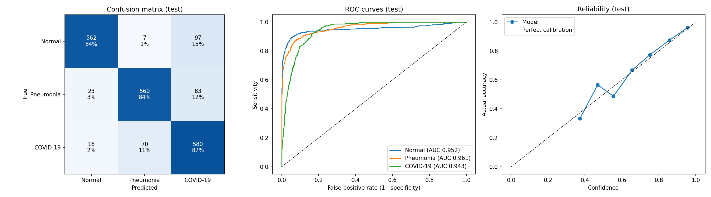
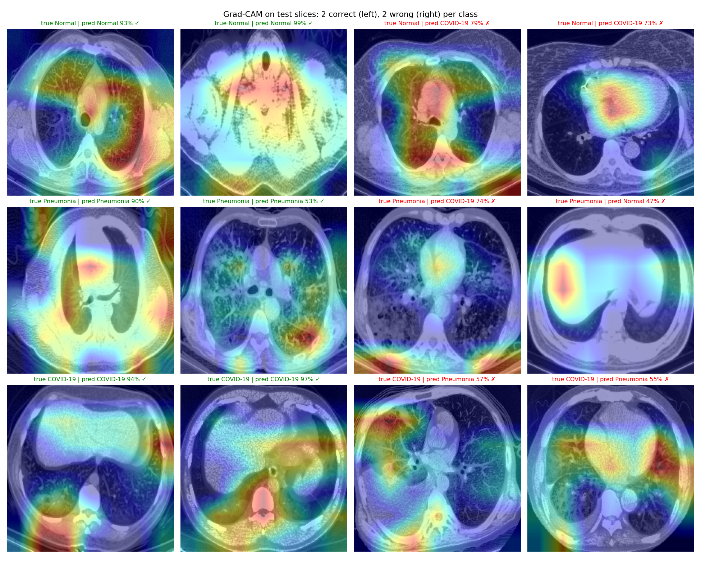

# Chest CT Classifier

Classifies axial chest CT slices as Normal, Pneumonia or COVID-19 using transfer learning
(EfficientNet-B0) on the COVIDx CT-3A dataset, served through a small Flask API with Grad-CAM.

This is a research and portfolio project, not a medical device.

## Results

Test set: 1,998 slices from 90 people who were never seen during training or model selection.
95% confidence intervals come from bootstrapping people, not slices.

| Metric | Value | 95% CI |
|---|---|---|
| Accuracy | 0.852 | 0.794 – 0.905 |
| Macro F1 | 0.853 | 0.790 – 0.905 |
| Macro AUC | 0.952 | 0.910 – 0.982 |

| Class | Sensitivity | Specificity |
|---|---|---|
| Normal | 0.844 | 0.971 |
| Pneumonia | 0.841 | 0.942 |
| COVID-19 | 0.871 | 0.865 |

- Per-person accuracy (averaging each person's slice predictions): 0.911
- Macro F1 on CNCB only (one hospital that contributes all three classes): 0.913



## What I found along the way

**The official splits leak one patient.** The dataset's train/val/test splits are disjoint by
patient ID, but TCIA lists two scans of the same person as separate patients
(`volume-covid19-A-0383_0` and `_1`). One ended up in train, the other in test. I group scans by
person and drop that person from train. `scripts/make_splits.py` checks for leakage and stops if
any person appears in two splits.

**Hospital and class are tangled together.** Several sources contribute only COVID scans
(STOIC, iCTCF, TCIA, Stony Brook), and most pneumonia comes from one hospital (CNCB). My first
model learned scanner style as a shortcut: on validation it called 121 COVID slices Normal, almost
all from hospitals that mostly sent Normal scans, while within CNCB it never made that mistake.

**Balancing by source helped.** Sampling training data evenly across hospitals within each class,
plus stronger intensity augmentation and label smoothing, raised COVID sensitivity on validation
from 0.575 to 0.724. Because these three changes were made together, I can't say which mattered most.

**Grad-CAM shows the model doesn't always look at the lungs.** Some correct predictions focus on
lesions, but others rely on the heart, spine or image edges.



## How it works

1. **Patient IDs.** Each of the 11 source hospitals names files differently.
   `src/ctclf/ids.py` maps every filename to a patient ID that matches `metadata.csv`
   (99.9% of training slices match; the rest are radiopaedia files missing from the metadata).
2. **Sampling.** About 15k training slices, at most 15 per person, spread evenly through each scan
   and balanced across classes and hospitals. Val and test: about 2k slices each, class-balanced.
3. **Training.** EfficientNet-B0 pretrained on ImageNet, fine-tuned on lung-cropped slices with
   histogram equalization, affine/brightness/blur/noise augmentation and label smoothing.
   Early stopping on validation macro F1. Trained on a Kaggle T4 GPU.
4. **Evaluation.** Sensitivity, specificity and AUC per class, person-level bootstrap CIs,
   a same-hospital (CNCB) check and a per-person score.

The full exploration, including the first experiment, is in `notebooks/kaggle_training.ipynb`.

## Running it

```bash
python -m venv .venv
.venv\Scripts\activate          # Windows
pip install -r requirements.txt
```

**Rebuild the splits.** Download `metadata.csv` and the three `*_COVIDx_CT-3A.txt` files from the
[COVIDx CT dataset](https://www.kaggle.com/datasets/hgunraj/covidxct) into `data/raw/`, then:

```bash
python scripts/make_splits.py
```

**Train and evaluate.** Needs the images and a GPU (I used Kaggle):

```bash
python scripts/train.py --image-dir /kaggle/input/datasets/hgunraj/covidxct/3A_images
python scripts/evaluate.py --image-dir /kaggle/input/datasets/hgunraj/covidxct/3A_images
```

**Run the API.** Put the trained weights at `checkpoints/best_exp2.pt`
(download from the Releases page), then:

```bash
flask --app app.main run
```

Open http://127.0.0.1:5000 to upload a slice, or call it directly:

```bash
curl -F "file=@slice.png" "http://127.0.0.1:5000/predict?explain=true"
```

**Tests.**

```bash
pytest
```

## Limitations

- Predictions are per slice. A clinical tool would decide per scan.
- The test set has only 90 people, so the confidence intervals are wide.
- Hospital bias is reduced, not removed. All test data comes from the same benchmark, so this
  hasn't been validated on a new hospital.
- Uploaded images are cropped with a simple brightness threshold, which only approximates the
  lung boxes used in training.

## Possible next steps

- Lung segmentation, so only lung tissue reaches the model
- Testing each Experiment 2 change separately (ablation)
- External validation on a dataset from a different hospital
- Combining slice predictions into one prediction per scan

## Data

COVIDx CT-3A by Gunraj, Tuinstra and Wong (COVID-Net initiative),
available on [Kaggle](https://www.kaggle.com/datasets/hgunraj/covidxct).
The dataset is not included in this repository.